# Create and access your first SKE cluster

This guide is for users who have received a Safespring portal account for
Safespring Kubernetes Engine (SKE). You will activate the required accounts,
create an environment and cluster, download its `kubeconfig`, and verify access
with `kubectl`.

## Activate your portal and identity accounts

As the first user for your domain you should have received three activation emails:

* **The portal** URL: https://portal.safespring.com
* **IDM in sto2** URL: https://sto2.idm.paas.safedc.net/
* **IDM in osl2** URL: https://osl2.idm.paas.safedc.net/

You should click the activation links in each and every one of the emails to ensure that you have all accounts you need in order to provision your services.

If you did not receive all three activation emails, contact your organization's
Safespring administrator or [Safespring support](../service/support.md) before
continuing.

## Prerequisites

Before you begin working with your Safespring Portal clusters, you need to have the following tools installed:

* **kubectl** - The Kubernetes command-line tool. See [Install and Set Up kubectl](https://kubernetes.io/docs/tasks/tools/)
* **kubelogin** - A kubectl plugin for OIDC authentication. This is required to authenticate to your clusters. See the [kubelogin setup guide](https://github.com/int128/kubelogin?tab=readme-ov-file#setup) for installation instructions.

## Logging into the portal

You are now ready to go to https://portal.safespring.com:

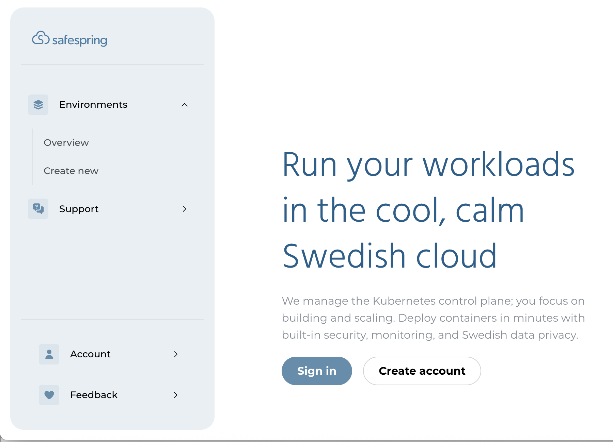

You click the "Sign in" button and you see this:

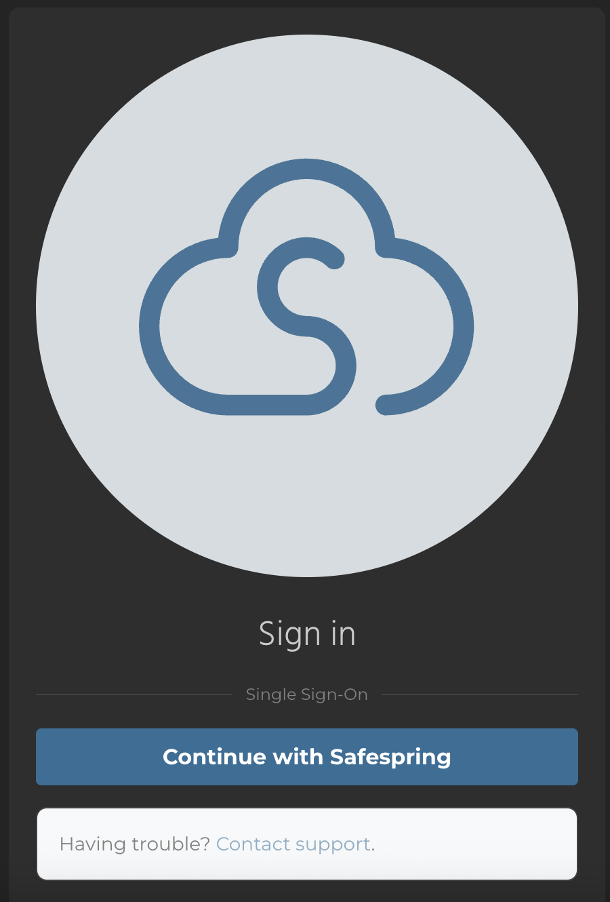

You click the "Continue with ZITADEL" and log in.

## Viewing your environments

Once you have logged in you will be greeted with your "Environments Overview". If this is the first time you login that listing will be empty:

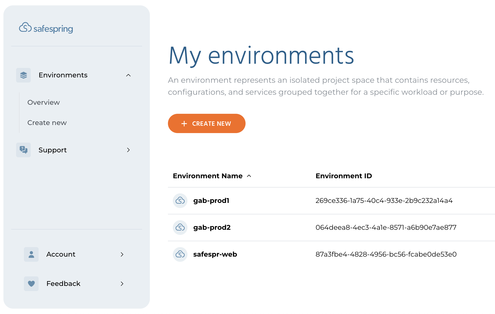
Environments is a way to group your resources into different separate environments in which you can run several clusters, compute projects or storage accounts.

You click "Create New" to create a new environment.

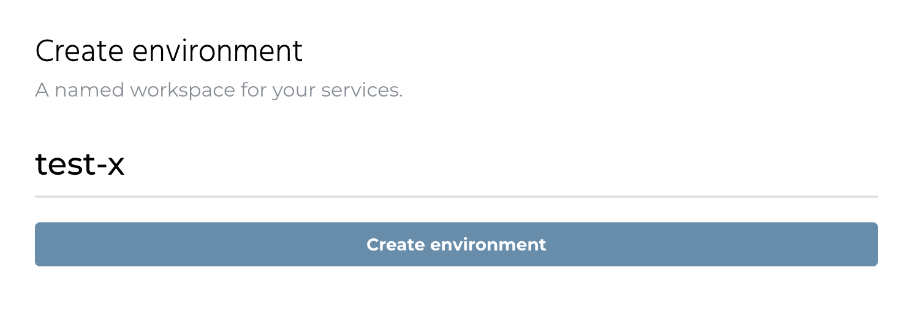

You give your environment a name and then click "Create environment".

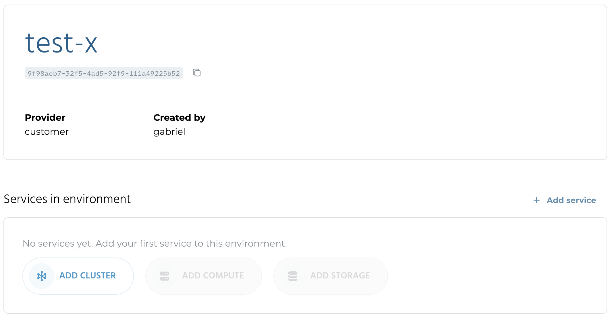
You now see your new environment, where you can start resources.

To delete an environment, see [Manage environments](environments.md#delete-an-environment).

## Create your first cluster

Click the button "Add Cluster" and give it a name:

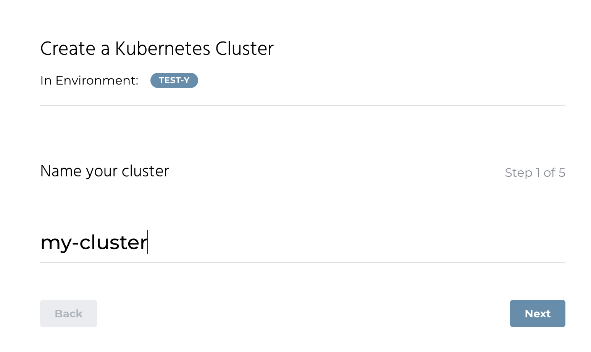

In the next step you pick which site you want to start your cluster in:

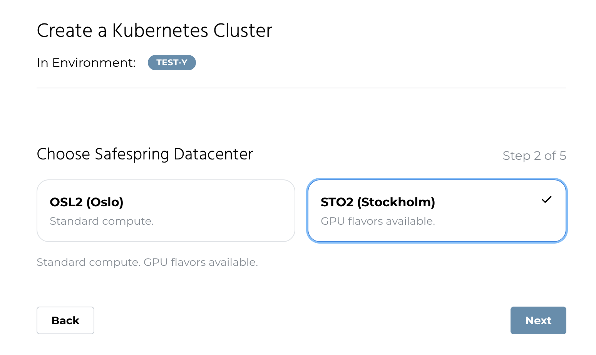

Now it is time to choose the specifications of the control nodes in the cluster:

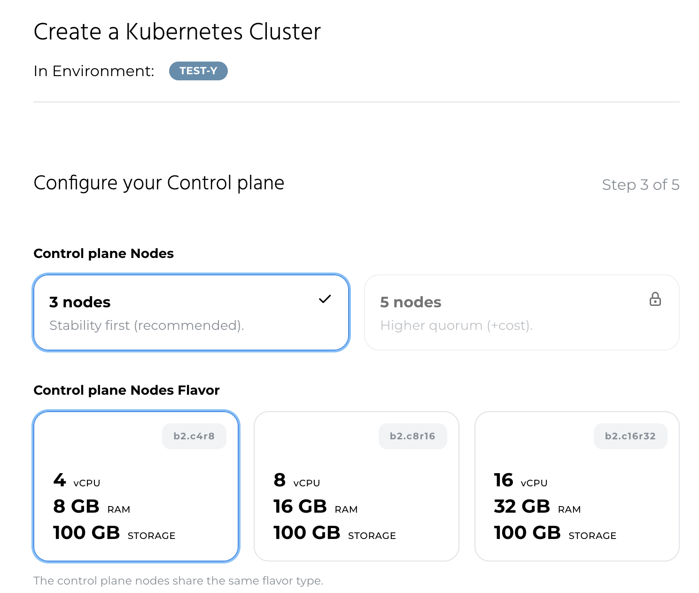

You can now choose how many worker nodes and how much resources each worker node should have:

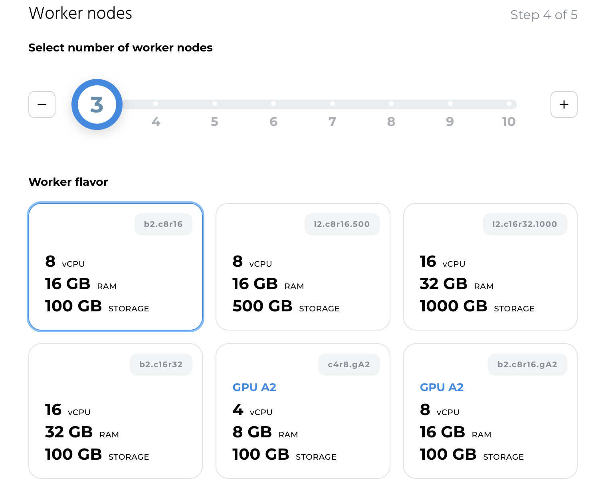

In the last step you review the cluster configuration for the cluster you are about to create. You can also download the cluster configuration JSON file for later reference:

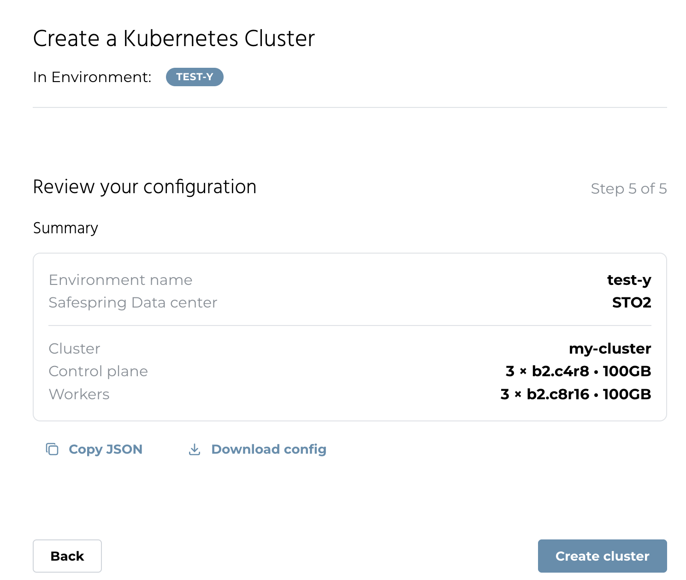

Your cluster is now creating.

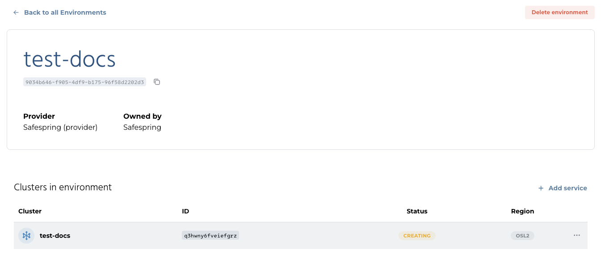

### Accessing Kubernetes Cluster

Wait a few minutes until the cluster status is **Active**. Click the cluster to open it and then click the **Kubeconfig** button. The "Service Credentials" dialog shows two [kubeconfig](https://kubernetes.io/docs/concepts/configuration/organize-cluster-access-kubeconfig/) files:

* **Browser Credential** logs you in through your web browser. Use it on your own computer.
* **Device Credential** prints a login link and code instead of opening a browser. Use it on a machine without a browser, for example over SSH.

The Browser Credential looks like this:

```yaml
...
  name: rh7gk6hod2xlymam
contexts:
- context:
    cluster: rh7gk6hod2xlymam
    user: oidc
  name: oidc@rh7gk6hod2xlymam
current-context: oidc@rh7gk6hod2xlymam
kind: Config
users:
- name: oidc
  user:
    exec:
      apiVersion: client.authentication.k8s.io/v1
      args:
      - oidc-login
      - get-token
...
```

The cluster and context are named after the cluster ID shown on the cluster page. Click **Copy Value** to copy the whole file.

Paste it into a file named `.kubeconfig` on the machine where you have kubectl installed and run:

```shell
➜ export KUBECONFIG=$(pwd)/.kubeconfig
➜ kubectl get nodes
```

You will get redirected to the IDP of the data center where you provisioned your cluster:

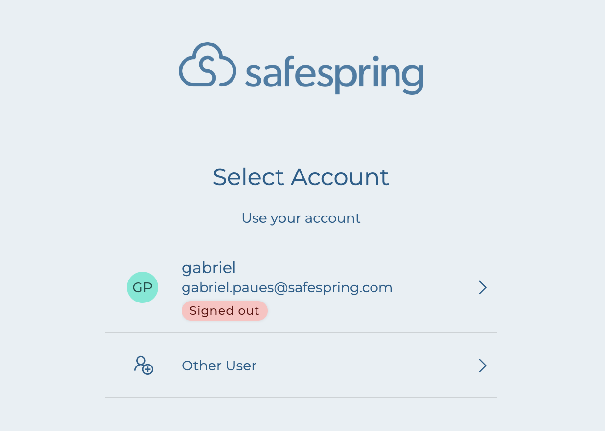

You enter your password:

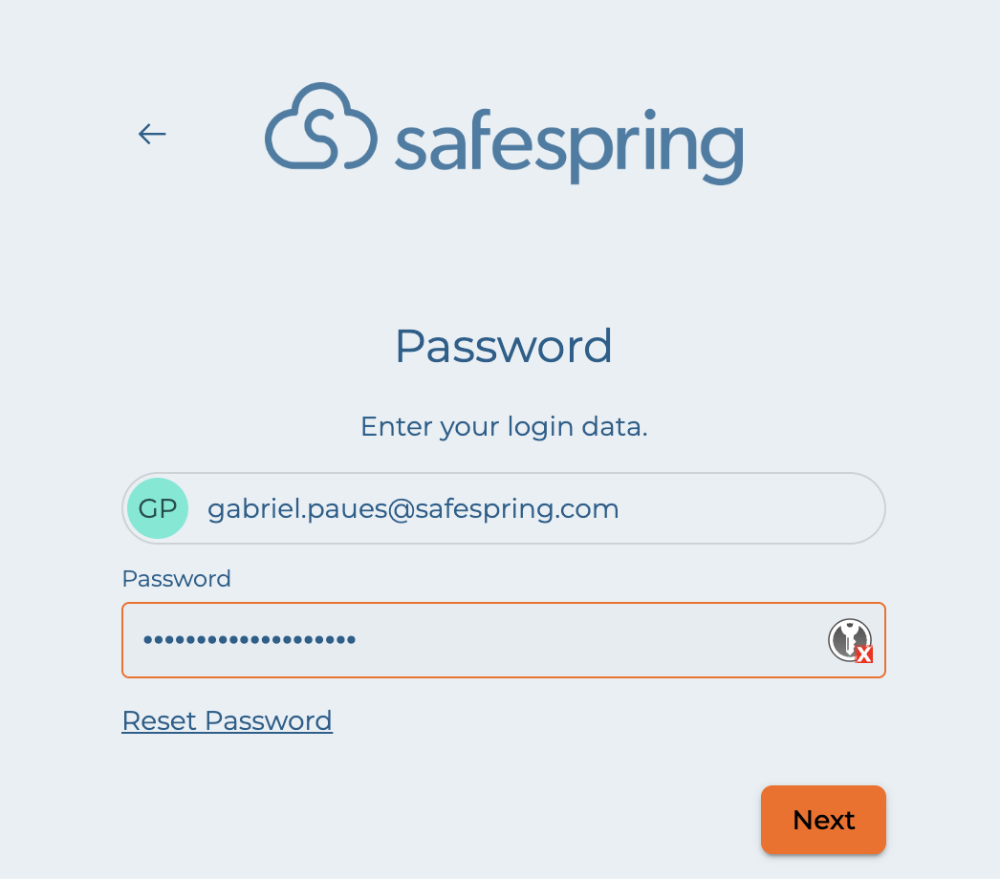

You will get a message that you have authenticated and if you go back to the terminal you will see the output of the command:

```shell
➜ kubectl get nodes
NAME                                    STATUS   ROLES           AGE     VERSION
rh7gk6hod2xlymam-cp-cf9z9               Ready    control-plane   8m35s   v1.36.5
rh7gk6hod2xlymam-cp-grpmd               Ready    control-plane   8m35s   v1.36.5
rh7gk6hod2xlymam-cp-mb7s4               Ready    control-plane   8m17s   v1.36.5
rh7gk6hod2xlymam-jgjm-wkr-ww6ll-5bc44   Ready    worker          8m32s   v1.36.5
rh7gk6hod2xlymam-jgjm-wkr-ww6ll-lrjl9   Ready    worker          8m31s   v1.36.5
rh7gk6hod2xlymam-jgjm-wkr-ww6ll-pqbgz   Ready    worker          8m35s   v1.36.5
```

Node names start with the cluster ID shown on the cluster page.

You can now start creating namespaces and start using your cluster.

For a graphical user interface for accessing the cluster please consult the [Kubernetes Dashboard guide](dashboard.md).
